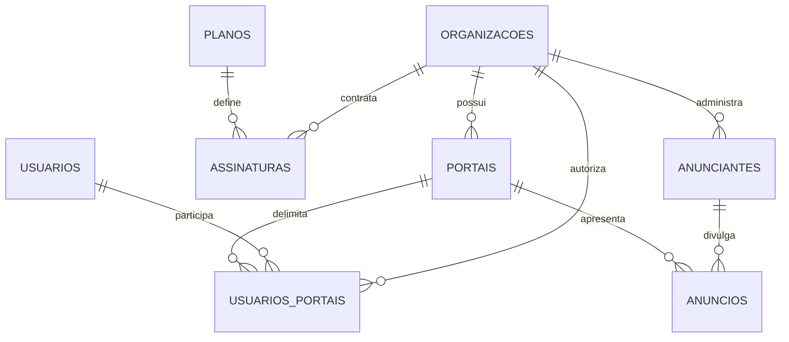
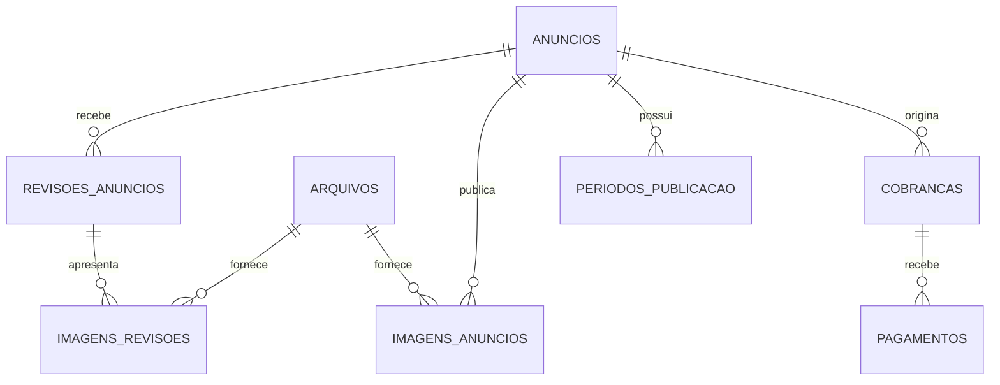
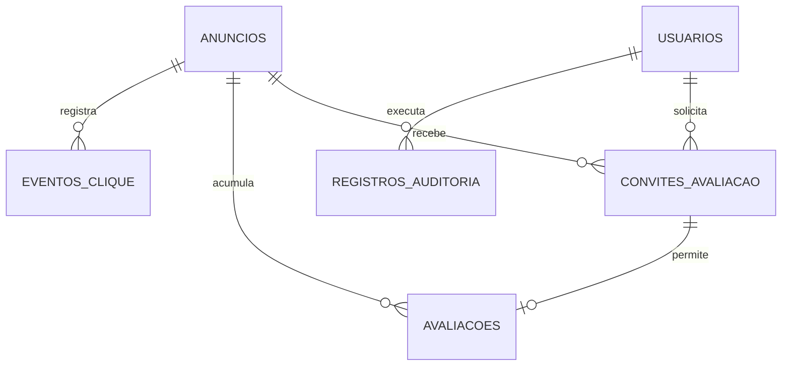

# Esquema do banco — Portal do Bairro

Este é o **modelo proposto com base no PRD**, incluindo os recursos que ainda serão implementados no banco existente. Todos os nomes de tabelas e campos ficam em português, sem acentos.

A separação principal será:

**Organização → Vitrine → Anunciantes → Anúncios → Revisões**

A Annecont será uma organização; condomínio e mercadinho serão outras. Cada registro operacional terá vínculo com sua organização para impedir acesso cruzado.

## 1. Visão dos relacionamentos

## 2. Convenções

| Item | Regra |
|---|---|
| Identificador | `id` como chave primária numérica. |
| Referência | Campos como `id_organizacao` serão chaves estrangeiras. |
| Valores financeiros | Inteiros em centavos, evitando erros de arredondamento. |
| Datas de eventos | `DATETIME` armazenado em UTC e exibido no horário local. |
| Períodos contratados | Campos `DATE` para início e fim, considerando o último dia inclusive. |
| Histórico | `criado_em`, `atualizado_em` e, quando necessário, autor da ação. |
| Exclusão | Preferir encerramento ou desativação de registros com histórico financeiro. |
| Situações | Valores controlados, como `pendente`, `aprovada` e `rejeitada`. |

Nas tabelas operacionais, o vínculo com a organização deve ser validado também nos relacionamentos: não basta que um identificador exista; ele precisa pertencer à mesma operação.

## 3. Organizações, vitrines e planos

### `organizacoes`

Representa quem contrata sua plataforma.

| Campo | Tipo | Finalidade |
|---|---|---|
| `id` | BIGINT | Identificador. |
| `nome` | VARCHAR(150) | Annecont, condomínio ou mercadinho. |
| `documento` | VARCHAR(20), opcional | CPF ou CNPJ, quando necessário. |
| `email_contato` | VARCHAR(254) | Contato administrativo. |
| `telefone_contato` | VARCHAR(20), opcional | Contato administrativo. |
| `situacao` | VARCHAR(20) | Ativa, suspensa ou encerrada. |
| `acesso_liberado_em` | DATETIME | Marco inicial da assinatura. |
| `criado_em`, `atualizado_em` | DATETIME | Controle de alterações. |

**Permissões:** master cadastra e administra; gestor consulta sua organização e altera somente os dados de contato permitidos; anunciante não acessa dados contratuais.

### `portais`

Representa a vitrine pública da organização.

| Campo | Tipo | Finalidade |
|---|---|---|
| `id` | BIGINT | Identificador. |
| `id_organizacao` | FK | Organização responsável. |
| `nome` | VARCHAR(150) | Nome público da vitrine. |
| `identificador` | VARCHAR(100), único | Endereço, como `/p/annecont`. |
| `descricao` | TEXT, opcional | Apresentação pública. |
| `id_arquivo_logotipo` | FK, opcional | Logotipo. |
| `cor_principal` | CHAR(7) | Cor hexadecimal. |
| `regiao_descricao` | VARCHAR(200), opcional | Região ou comunidade atendida. |
| `situacao` | VARCHAR(20) | Ativo ou desativado. |
| `criado_em`, `atualizado_em` | DATETIME | Histórico. |

**Permissões:** master administra; gestor edita identidade da sua vitrine; público consulta apenas informações de vitrines ativas.

### `planos`

| Campo | Tipo | Finalidade |
|---|---|---|
| `id` | BIGINT | Identificador. |
| `nome` | VARCHAR(100) | Nome comercial. |
| `limite_espacos` | INT | Capacidade, como 10 ou 20. |
| `valor_mensal_centavos` | INT | Valor de referência. |
| `ativo` | BOOLEAN | Disponível para novas contratações. |

**Permissões:** master edita; gestor consulta seu plano contratado; anunciante não acessa.

### `assinaturas`

Guarda as condições efetivamente contratadas, preservando-as mesmo se o plano mudar.

| Campo | Tipo | Finalidade |
|---|---|---|
| `id` | BIGINT | Identificador. |
| `id_organizacao` | FK | Contratante. |
| `id_plano` | FK | Plano de origem. |
| `limite_espacos_contratado` | INT | Limite acordado. |
| `valor_mensal_centavos` | INT | Preço acordado. |
| `inicio_em` | DATE | Início da assinatura. |
| `encerrada_em` | DATE, opcional | Encerramento. |
| `situacao` | VARCHAR(20) | Ativa, suspensa ou encerrada. |

**Permissões:** master edita; gestor consulta somente sua assinatura.

## 4. Login e vínculos de acesso

### `usuarios`

| Campo | Tipo | Finalidade |
|---|---|---|
| `id` | BIGINT | Identificador. |
| `nome` | VARCHAR(150) | Nome do usuário. |
| `email` | VARCHAR(254), único | Login. |
| `senha_hash` | VARCHAR(255) | Senha protegida, nunca em texto aberto. |
| `administrador_master` | BOOLEAN | Permissão global concedida apenas pelo master. |
| `ativo` | BOOLEAN | Acesso habilitado. |
| `ultimo_acesso_em` | DATETIME, opcional | Último login. |
| `criado_em`, `atualizado_em` | DATETIME | Histórico. |

### `usuarios_portais`

| Campo | Tipo | Finalidade |
|---|---|---|
| `id` | BIGINT | Identificador. |
| `id_usuario` | FK | Usuário autorizado. |
| `id_organizacao` | FK | Operação autorizada. |
| `id_portal` | FK | Vitrine autorizada. |
| `id_anunciante` | FK, opcional | Empresa acessível ao anunciante. |
| `perfil` | VARCHAR(20) | Gestor ou anunciante. |
| `ativo` | BOOLEAN | Vínculo habilitado. |
| `criado_em` | DATETIME | Criação do acesso. |

**Regra:** perfil anunciante exige `id_anunciante`; perfil gestor permite administrar as empresas do portal autorizado.

**Permissões:** master administra os vínculos; gestor cria e desativa acessos de seus anunciantes; cada usuário altera sua própria senha. Ninguém consulta a senha, nem mesmo o master.

### `tokens_acesso`

Atende primeiro acesso e recuperação de senha.

**Campos:** `id`, `id_usuario`, `finalidade`, `token_hash`, `expira_em`, `utilizado_em`, `criado_em`.

**Permissões:** somente o sistema cria e valida; o usuário utiliza o link, sem consultar registros ou hashes.

Sessões e tentativas de login terão tabelas técnicas próprias, sem acesso pelo painel comum.

## 5. Empresas e anúncios

### `anunciantes`

Representa a empresa cadastrada na carteira do gestor.

| Campo | Tipo | Finalidade |
|---|---|---|
| `id` | BIGINT | Identificador. |
| `id_organizacao` | FK | Organização responsável. |
| `nome_fantasia` | VARCHAR(150) | Nome da empresa. |
| `razao_social` | VARCHAR(200), opcional | Informação administrativa. |
| `documento` | VARCHAR(20), opcional | CPF ou CNPJ. |
| `nome_responsavel` | VARCHAR(150) | Responsável pelo cadastro. |
| `email_responsavel` | VARCHAR(254) | Contato administrativo. |
| `telefone_responsavel` | VARCHAR(20), opcional | Contato administrativo. |
| `situacao` | VARCHAR(20) | Ativo ou encerrado. |
| `criado_em`, `atualizado_em` | DATETIME | Histórico. |

**Permissões:** gestor administra os dados cadastrais; anunciante consulta seus dados e edita o conteúdo de divulgação pelo anúncio; público não acessa documentos nem contatos administrativos.

### `categorias`

**Campos:** `id`, `nome`, `identificador`, `ativo`.

**Permissões:** master mantém a lista inicial; gestor e anunciante selecionam; público consulta categorias ativas.

### `anuncios`

Guarda a **versão pública aprovada** e as condições comerciais do espaço.

| Campo | Tipo | Finalidade |
|---|---|---|
| `id` | BIGINT | Identificador. |
| `id_organizacao`, `id_portal`, `id_anunciante` | FKs | Proprietários do espaço. |
| `id_categoria` | FK | Categoria pública aprovada. |
| `titulo` | VARCHAR(150) | Nome exibido. |
| `descricao` | TEXT | Apresentação. |
| `servicos` | TEXT | Serviços divulgados. |
| `whatsapp` | VARCHAR(20), opcional | Contato público. |
| `instagram` | VARCHAR(255), opcional | Link público. |
| `horario` | VARCHAR(250), opcional | Horários de atendimento. |
| `endereco` | VARCHAR(300), opcional | Localização pública autorizada. |
| `area_atendimento` | VARCHAR(300), opcional | Área atendida. |
| `situacao_publicacao` | VARCHAR(20) | Não publicado, publicado ou despublicado. |
| `acesso_liberado_em` | DATETIME | Início da ocupação do espaço. |
| `primeira_publicacao_em` | DATETIME, opcional | Início da cobrança do anunciante. |
| `mensalidade_centavos` | INT | Valor acordado com o gestor. |
| `id_revisao_aprovada` | FK, opcional | Origem do conteúdo público. |
| `despublicado_em` | DATETIME, opcional | Última despublicação. |
| `motivo_despublicacao` | TEXT, opcional | Justificativa obrigatória nessa ação. |
| `encerrado_em` | DATETIME, opcional | Encerramento do vínculo comercial. |
| `criado_em`, `atualizado_em` | DATETIME | Histórico. |

**Restrições:** um anúncio por empresa em cada portal; criação e liberação de acesso ocupam espaço; despublicar não libera espaço automaticamente.

**Permissões:** público consulta somente conteúdo aprovado de anúncios publicados; gestor administra condições comerciais e publicação; anunciante altera conteúdo somente por revisão.

### `revisoes_anuncios`

| Campo | Tipo | Finalidade |
|---|---|---|
| `id` | BIGINT | Identificador. |
| `id_organizacao`, `id_anuncio` | FKs | Escopo. |
| `id_autor` | FK de usuário | Quem preparou a alteração. |
| `conteudo` | JSON | Cópia completa dos campos de divulgação propostos. |
| `situacao` | VARCHAR(20) | Rascunho, pendente, aprovada ou rejeitada. |
| `versao` | INT | Detectar alterações durante a análise. |
| `id_revisor` | FK, opcional | Quem decidiu. |
| `parecer` | TEXT, opcional | Obrigatório na rejeição. |
| `enviado_em` | DATETIME, opcional | Submissão. |
| `analisado_em` | DATETIME, opcional | Decisão. |
| `criado_em`, `atualizado_em` | DATETIME | Histórico. |

**Escolha:** JSON simplifica o armazenamento do retrato completo da proposta; os campos públicos continuam estruturados em `anuncios`.

**Permissões:** anunciante prepara e envia suas revisões; gestor compara e decide; revisões já analisadas ficam preservadas; público não acessa.

## 6. Imagens

### `arquivos`

**Campos:** `id`, `id_organizacao`, `id_usuario_envio`, `caminho_interno`, `tipo_mime`, `tamanho_bytes`, `largura`, `altura`, `criado_em`.

O caminho interno nunca será exposto diretamente.

### `imagens_revisoes`

**Campos:** `id`, `id_organizacao`, `id_revisao`, `id_arquivo`, `posicao`, `legenda`.

### `imagens_anuncios`

**Campos:** `id`, `id_organizacao`, `id_anuncio`, `id_arquivo`, `posicao`, `legenda`.

**Regras:**

- Posição `1`: imagem principal.
- Posições `2` e `3`: complementares.
- Posição única dentro de cada anúncio ou revisão.
- Arquivos podem ser referenciados por versões diferentes, evitando duplicação.
- Remover uma imagem da proposta não apaga a imagem publicada ou seu histórico.

**Permissões:** anunciante e gestor gerenciam imagens da proposta; somente aprovação altera as imagens públicas; público visualiza apenas arquivos liberados pela versão publicada.

## 7. Cobranças, pagamentos e períodos

### `cobrancas`

Uma única estrutura atenderá as duas relações comerciais, mantendo acesso separado.

| Campo | Tipo | Finalidade |
|---|---|---|
| `id` | BIGINT | Identificador. |
| `id_organizacao` | FK | Organização relacionada. |
| `tipo` | VARCHAR(30) | Assinatura da plataforma ou mensalidade do anúncio. |
| `id_assinatura` | FK, opcional | Preenchido na cobrança ao gestor. |
| `id_anuncio` | FK, opcional | Preenchido na cobrança ao anunciante. |
| `descricao` | VARCHAR(250) | Referência da cobrança. |
| `valor_centavos` | INT | Valor devido. |
| `inicio_referencia`, `fim_referencia` | DATE | Período cobrado. |
| `vencimento` | DATE | Data-limite. |
| `situacao` | VARCHAR(20) | Aberta, paga ou cancelada. |
| `criado_por` | FK de usuário | Responsável pelo lançamento. |
| `criado_em` | DATETIME | Registro. |

**Regra:** cada cobrança aponta para uma assinatura ou um anúncio, nunca para ambos. A condição “vencida” pode ser calculada pela data e pela situação, sem atualização diária obrigatória.

### `pagamentos`

**Campos:** `id`, `id_organizacao`, `id_cobranca`, `valor_centavos`, `recebido_em`, `forma_pagamento`, `observacao`, `registrado_por`, `criado_em`.

**Regra:** correções devem manter rastreabilidade; pagamentos não serão apagados silenciosamente.

### `periodos_publicacao`

**Campos:** `id`, `id_organizacao`, `id_anuncio`, `id_cobranca`, `inicio_em`, `fim_em`, `registrado_por`, `criado_em`.

**Regra:** o fim do período gera pendência, sem alterar automaticamente a publicação; pagamento e renovação são ações separadas.

**Permissões financeiras:**

| Dado | Master | Gestor | Anunciante |
|---|---|---|---|
| Cobrança da plataforma ao gestor | Cria e registra pagamento | Consulta a própria | Sem acesso |
| Mensalidade do anunciante | Administra | Cria e registra pagamento na sua operação | Consulta a própria |
| Período de divulgação | Administra | Define e renova | Consulta o próprio |
| Valor mensal do anunciante | Administra | Define | Consulta |

## 8. Avaliações

### `convites_avaliacao`

| Campo | Tipo | Finalidade |
|---|---|---|
| `id` | BIGINT | Identificador. |
| `id_organizacao`, `id_anuncio` | FKs | Empresa avaliada. |
| `id_solicitante` | FK de usuário | Quem pediu o envio. |
| `email_destinatario` | VARCHAR(254) | Destino do convite. |
| `identificador_email` | CHAR(64) | HMAC do e-mail normalizado para controle de repetição. |
| `token_hash` | CHAR(64), único | Validação segura do link. |
| `expira_em` | DATETIME, opcional | Prazo ainda a definir. |
| `enviado_em` | DATETIME, opcional | Envio realizado. |
| `utilizado_em` | DATETIME, opcional | Consumo do link. |
| `criado_em` | DATETIME | Solicitação. |

### `avaliacoes`

**Campos:** `id`, `id_organizacao`, `id_anuncio`, `id_convite`, `identificador_email`, `estrelas`, `situacao`, `criado_em`.

**Restrições:**

- Estrelas entre `1` e `5`.
- Um registro por convite.
- Intervalo mínimo de 24 horas por e-mail e anúncio.
- Consumo do convite e gravação da avaliação na mesma transação.
- Verificação de intervalo protegida contra envios simultâneos.

**Permissões:** cliente envia uma nota pelo token; público vê reputação agregada; anunciante acompanha suas avaliações e convites, mas não altera notas; gestor não edita estrelas.

Qualquer futura invalidação por fraude deverá exigir justificativa e auditoria, sem permitir manipular o ranking comercialmente.

## 9. Métricas, mensagens e auditoria

### `eventos_clique`

**Campos:** `id`, `id_organizacao`, `id_portal`, `id_anuncio`, `canal`, `identificador_sessao`, `criado_em`.

**Permissões:** sistema registra; anunciante consulta totais do próprio anúncio; gestor consulta os de sua vitrine; master consulta o conjunto.

Os cliques indicam intenção de contato, não contratação confirmada.

### `fila_emails`

**Campos:** `id`, `id_organizacao`, `id_convite`, `tipo`, `destinatario`, `dados_mensagem`, `situacao`, `tentativas`, `proxima_tentativa_em`, `enviado_em`, `ultimo_erro`, `criado_em`.

**Permissões:** sistema envia e atualiza; interfaces exibem somente a situação necessária, sem expor conteúdo técnico ou tokens.

Dados temporários sensíveis da mensagem deverão ser protegidos e removidos quando não forem mais necessários.

### `registros_auditoria`

**Campos:** `id`, `id_organizacao`, `id_usuario`, `acao`, `entidade`, `id_registro`, `dados_anteriores`, `dados_novos`, `criado_em`.

**Permissões:** sistema grava; master consulta; gestor consulta eventos permitidos da própria operação; ninguém edita pelo painel.

Senhas, tokens e outros segredos não entram na auditoria.

**Favoritos:** na primeira versão ficam no navegador, conforme o TRD; portanto, não precisam de tabela.

## 10. Resumo de quem vê e edita

| Informação | Público | Anunciante | Gestor | Master |
|---|---|---|---|---|
| Anúncio aprovado e publicado | Vê | Vê | Vê | Vê |
| Proposta ainda não publicada | Não | Vê e edita a própria | Vê e prepara alterações da sua vitrine | Vê e prepara |
| Aprovação e rejeição | Não | Consulta resultado próprio | Decide na sua vitrine | Decide |
| Dados administrativos da empresa | Não | Consulta os próprios | Administra os seus | Administra |
| Mensalidade do anunciante | Não | Consulta a própria | Administra as suas | Administra |
| Contrato do gestor com a plataforma | Não | Não | Consulta o próprio | Administra |
| E-mails de clientes convidados | Não | Acessa os convidados do próprio anúncio | Acesso restrito à necessidade operacional | Acesso administrativo auditado |
| Notas das avaliações | Vê agregados | Consulta, sem editar | Consulta, sem editar | Sem edição direta |
| Documentos, senhas e tokens | Não | Nunca acessa segredos | Nunca acessa segredos | Nunca acessa segredos |
| Dados de outra organização | Apenas conteúdo público | Não | Não | Acesso administrativo |

**Regra central de segurança:** toda consulta e alteração deve validar usuário, perfil, organização e propriedade do registro no servidor; esconder botões na interface não protege os dados.

**Decisões ainda pendentes:** liberação do espaço após encerramento, prazo dos convites, retenção de dados pessoais e regra de republicação após suspensão. Essas decisões devem ser fechadas antes de implementar exclusões e rotinas automáticas.
